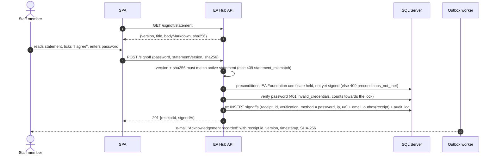

# EA Awareness Hub: reference backend

This is the REST API for the General Tax Authority (GTA) EA Awareness Hub. It does five things:

- signs staff up once with a code sent to their GTA e-mail, then signs them in with GTA e-mail + password (codes again only for a forgotten password);
- records learning activity and assessment attempts, and re-scores each attempt on the server;
- takes the acknowledgement sign-off, confirmed with the user's password;
- runs three certification paths — Foundation (unlock at 80 % of EA modules and TOGAF topics; sampled 3-part exam), Practitioner (Foundation certificate + 80 % of Practitioner knowledge-base articles) and Advanced (Practitioner certificate + 80 % of Advanced articles) — each with 3 attempts and a 70 % pass mark; issues one certificate per level with a public verification endpoint and e-mails them;
- emails a receipt for each sign-off (sign-off requires the certificate);
- serves the admin dashboard and CSV exports.

The contract is in [`../docs/api-contract.md`](../docs/api-contract.md). This server implements it at `/api/v1`. `npm start` also serves the static SPA from the parent folder, so the whole app runs at <http://localhost:8080>.

## Quick start (local dev)

```bash
cd server
cp .env.example .env          # optional: defaults work for local dev
npm install
npm run seed:demo             # optional: about 180 demo users and 45 days of activity (wipes users/activity in the dev DB)
npm start                     # http://localhost:8080  (API at /api/v1)
npm test                      # node:test + supertest against an in-memory SQLite DB
```

If `SMTP_HOST` is empty, every e-mail is printed to the server console as a `dev-mail` log line, including OTP codes. Each message is also kept in the `email_outbox` table. To use an admin account after `seed:demo`, sign up once as `ea.admin@gta.gov.qa` (read the code from the console, then choose a password), or set a password directly with `npm run set-password -- ea.admin@gta.gov.qa '<password>'`. Any other address listed in `ADMIN_EMAILS` gets the admin role the first time it signs in.

| Script | Purpose |
|---|---|
| `npm start` / `npm run dev` | Run the server (`dev` uses `node --watch`) |
| `npm run create-reviewer [-- <email> <password>]` | Creates or refreshes the exam-reviewer account (default `exam.reviewer@gta.gov.qa` / `GtaExams2026!`): display name "Exam Reviewer", Information Technology, role `ea_team`, password set, every module / TOGAF topic / knowledge-base article marked complete. The address must be in `REVIEWER_EMAILS`. Reviewers can open every exam at any time, as often as they like, never receive certificates, cannot sign off and are left out of all dashboards and exports. `seed:demo` runs this automatically |
| `npm run set-password -- <email> <password>` | Sets (or resets) a password from the console, creating the account if needed; applies the password policy and clears any lock |
| `npm test` | API tests (domain rejection, sign-up with code + password, login, wrong password / password not set, 5-failure lock, reset, password change, code lockout, sessions, heartbeat, re-scoring, sign-off, outbox, admin access) certification tests against the real content (unlock rule, sampling, resume, exact-set validation, attempts, grants, certificate, verification, dashboard, employees export) and certification-path tests (prerequisite certificates, knowledge-base tracks, per-level attempts / grants / certificates, verify level, sign-off needs only Foundation, per-level dashboard) and exam-reviewer tests (create-reviewer idempotent, all levels open, unlimited preview sittings, no certificates, no sign-off, excluded from reporting) |
| `npm run sync:content` | **Run this first.** Reads `../js/data` (modules, rounds, answer keys, sign-off statement), regenerates `src/seed/questions.json`, upserts it, deactivates placeholder rows and publishes the statement with the same SHA-256 the browser computes |
| `npm run seed:questions [-- file.json]` | Upsert modules, rounds and question answer keys from `src/seed/questions.json` |
| `npm run seed:demo [-- --users 250 --days 60 --seed 7]` | Generate demo data for the dashboard. Dev only: it refuses to run on SQL Server without `--force` |

## Architecture

```
 Browser (vanilla-JS SPA, js/api.js)
        │  HTTPS, JSON, Authorization: Bearer <JWT>
        ▼
 Reverse proxy (IIS/ARR or k8s/OpenShift ingress)  ── TLS termination, X-Forwarded-For
        ▼
 Node.js / Express (this server)
   helmet · CORS · express-rate-limit · JSON body limit 256 KB
   routes/      auth · me/events · quiz · signoff · admin
   services/    otp · credentials · users · progress · quiz (re-scoring) · signoff · dashboard · audit
   mail/        templates (HTML+text, GTA maroon, bilingual subjects) · outbox worker
   db/          data-access interface ── sqlite.js (dev/tests) | sqlserver.js (production, mssql)
        │                                   │
        ▼                                   ▼
 SQL Server (schema ea)               SMTP relay ── Exchange / Microsoft 365
```

* **Data access.** Services use one small async interface: `all/get/run/insert/tx/migrate/close`. They write portable SQL with named `@params` and no dialect-specific functions. Timestamps are bound from JS `Date` values. `LIMIT`/`TOP` is passed as an option, and inserts use `RETURNING` on SQLite or `OUTPUT INSERTED` on SQL Server. Switching to SQL Server is configuration only: `DB_DRIVER=mssql` plus `MSSQL_CONNECTION_STRING`. The application SQL uses unqualified table names, so the SQL Server login needs `DEFAULT_SCHEMA = ea`. The bottom of `db/schema.sqlserver.sql` shows how to set it.
* **Schema.** `db/schema.sqlserver.sql` is the production T-SQL DDL. It has idempotent tables, FKs, check constraints, `ISJSON` guards, indexes for the dashboard queries, the reporting views `ea.v_user_progress`, `ea.v_logins_by_day`, `ea.v_department_summary` and `ea.v_question_stats`, and seed data. `db/schema.sqlite.sql` is the SQLite equivalent and is applied automatically on start-up.
* **Passwords.** Hashed with Node's built-in `crypto.scrypt` (N=16384, r=8, p=1, 16-byte salt, 64-byte key; stored as `scrypt$N$r$p$salt$hash`) and compared in constant time; unknown e-mails are checked against a dummy hash so timing does not reveal accounts. Policy: 10–128 characters, at least one letter and one digit, no e-mail name, not a common password. `LOGIN_MAX_FAILURES` (5) consecutive wrong passwords — at sign-in, password change or sign-off — lock the account for `LOGIN_LOCK_MIN` (15) minutes; success or a reset clears the counter. Hashing always runs outside database transactions.
* **Sessions.** Each successful sign-up, reset or password sign-in inserts a `user_sessions` row with login time, IP and User-Agent. The JWT (HS256, `JWT_TTL`, default 8h) carries the session id and `jti`. Every request checks that this row is still open, so logout really ends the session. The user's role is always re-read from the database. `POST /auth/heartbeat` updates `last_seen_at`, and session duration is `logout_at` (or else `last_seen_at`) minus `login_at`.
* **One-time codes (sign-up and reset only).** Verifying a code returns a set-password JWT (audience `gta-ea-hub-setup`, `SETUP_TOKEN_TTL_MIN`, single use: the consumed challenge id is recorded in `audit_log` with the password change). Codes are 6 digits from `crypto.randomInt`. The database stores only `HMAC-SHA256(pepper, salt‖code)`, with a 16-byte salt per challenge. The pepper is `OTP_PEPPER`, falling back to `JWT_SECRET`, and is never stored in the database. Codes are compared in constant time. Each code is valid for 10 minutes and allows 5 attempts. The attempt counter is incremented atomically *before* the comparison, outside any business transaction, so parallel guesses cannot exceed the limit and failed attempts are never rolled back. A code can be requested at most 3 times per e-mail and purpose in 15 minutes. There is also a per-IP limiter.
* **Outbox.** OTP and receipt e-mails are inserted into `email_outbox` in the same transaction as the business write. A worker polls every `OUTBOX_POLL_MS` (5 s by default). It is also kicked immediately after an OTP request so codes arrive quickly. Each row is claimed optimistically, so several instances can share one outbox. Failed sends retry with exponential backoff (30 s, 60 s, 120 s … capped at 1 h) up to `OUTBOX_MAX_ATTEMPTS`, then the row is marked `failed`. With real SMTP, the OTP code is redacted from the stored payload once the row is sent or failed.
* **Scoring.** The server is authoritative. Each answer is scored against `questions.answer_key`. Supported types are `mcq`, `truefalse`, `order` (exact order), `match` and `categorize` (same set of pairs, any order). A correct answer earns full points; anything else earns 0. The `correct` and `points` values sent by the client are ignored; the client's `correct` is kept in `quiz_answers.client_correct` for diagnostics only.
* **Audit.** Logins, OTP lockouts, logouts, profile changes, exam starts/submissions, certificates, attempt grants, sign-offs and admin exports are written to `audit_log`.

### First-time sign-up (code once) and everyday sign-in (password)

```mermaid
sequenceDiagram
    autonumber
    actor U as Staff member
    participant SPA as SPA (browser)
    participant API as EA Hub API
    participant DB as SQL Server
    participant W as Outbox worker
    participant MX as Exchange / M365 relay
    U->>SPA: "Create account" — enters name@gta.gov.qa
    SPA->>API: POST /auth/otp/request {email, purpose:"signup"}
    API->>API: domain allow-list, per-email limit (3 / 15 min), 409 account_exists if a password is already set
    API->>DB: INSERT otp_challenges (HMAC hash, salt, expires +10 min) + email_outbox (tx)
    API-->>SPA: 202 {challengeId, expiresAt, maskedEmail}
    W->>MX: SMTP "Your sign-up code" (HTML + text)
    MX-->>U: e-mail with 6-digit code
    U->>SPA: types code
    SPA->>API: POST /auth/otp/verify {challengeId, code}
    API->>DB: attempts = attempts + 1 (atomic, max 5); constant-time compare; consumed_at
    API-->>SPA: 200 {setupToken (15 min, single use), purpose, email}
    U->>SPA: chooses a password
    SPA->>API: POST /auth/password {setupToken, password}
    API->>API: policy check, scrypt hash (outside the transaction)
    API->>DB: tx: provision user; store hash; audit user.password_set; INSERT user_sessions (login_at, ip, ua)
    API-->>SPA: 200 {token (JWT 8h), user}
    Note over U,API: Every later visit
    SPA->>API: POST /auth/login {email, password}
    API->>DB: verify scrypt hash; count failures (5 → locked 15 min); INSERT user_sessions
    API-->>SPA: 200 {token, user} | 401 invalid_credentials | 409 password_not_set | 423 account_locked
    loop every 60 s while tab visible
        SPA->>API: POST /auth/heartbeat
        API->>DB: UPDATE user_sessions.last_seen_at
    end
```

A forgotten password uses the same three steps with `purpose:"reset"` (the
request always answers 202 so it cannot be used to discover accounts).

### Sign-off (acknowledgement) confirmed with the password



## API notes and interpretations of the contract

| Topic | Behaviour |
|---|---|
| HTTP status per error code | `validation` 400, `weak_password` 400, `invalid_domain` 400, `unauthorized` 401, `invalid_credentials` 401, `otp_invalid` 401, `password_not_set` 409, `account_exists` 409, `account_locked` 423, `gone` 410, `forbidden` 403, `preconditions_not_met` 409, `statement_mismatch` 409, `otp_expired` 410, `otp_locked` 423, `rate_limited` 429. `not_found` (404) and `internal` (500) are also used, for unknown routes and unexpected errors. |
| Lockout | Wrong codes 1–4 return `otp_invalid` with the number of attempts left. The 5th wrong code returns `otp_locked`, and from then on the challenge is refused even with the right code. The user must request a new code. |
| `POST /auth/password`, `POST /auth/login` | Return `{ token, user }` plus an extra `expiresAt` field. |
| `progress.attempts[]` | `bestScore`/`maxScore` come from the attempt with the best percentage. There is an extra `passed` field (true if any attempt in that round passed). |
| `PATCH /me` department | Accepts a department name, code or Arabic name. It can be set once; changing it later returns `403 forbidden`, and the EA team must change it. |
| Events | `ref` is required (1–200 characters) for every type. `meta` must be a JSON object of at most 4 KB. `module_complete` events whose `ref` equals a `content_modules.id` count toward the sign-off preconditions. |
| Attempts | Every `questionId` must be an active question of `roundId`. Unknown ids, ids from another round and duplicates all return `validation`. An attempt must answer `quiz_rounds.questions_per_attempt` questions; `NULL` means every active question in the round. `maxScore` is the sum of points of the answered questions. The pass mark is `quiz_rounds.pass_pct`, default 70 (`PASS_PCT`). |
| Sign-off twice | Returns `409 preconditions_not_met` ("already signed"). |
| Certification | See the *Certification paths* section of `docs/api-contract.md`. Config: `CERT_UNLOCK_PCT` (80), `CERT_PASS_PCT` (70), `CERT_MAX_ATTEMPTS` (3, per level), `CERT_PREFIX` (`GTA-EAF`), `CERT_PREFIX_PRACTITIONER` (`GTA-EAP`), `CERT_PREFIX_ADVANCED` (`GTA-EAA`); level definitions in `src/config.js` (`certLevels`, mirror of `js/config.js`). `npm run sync:content` also loads every knowledge-base article as module `kb:<id>` (track `kbf`/`kbp`/`kba`) and each round's `level`. Existing SQLite dev databases are upgraded in place on start-up (columns added; `content_modules`, `cert_exams`, `certificates`, `cert_attempt_grants` rebuilt in one transaction with `level = 'foundation'` for existing rows); the SQL Server script is idempotent and does the same. |
| Dashboard `from`/`to` | Local dates (`YYYY-MM-DD`, Asia/Qatar, both inclusive) or ISO instants. The default is the last 30 days. Range figures (KPIs, logins, heatmap, score distribution, question stats, module views, recent sign-offs) cover the window. `funnel`, `byDepartment` and `signoffRatePct` are cumulative up to `to`. `passRatePct` is users with a passed attempt divided by users who attempted, within the window. `avgScorePct` and `scoreDistribution` are per attempt. The response also includes an extra `range` echo. |
| `GET /admin/users` | `status` ∈ `signed`, `passed` (passed but not signed), `in_progress`, `not_started`, `pending` (anything not signed). `bestScore` is the best attempt **percentage**. Each item also carries a `status` field. |
| `GET /admin/export` | Optional `from`, `to` and `department` filters. The CSV is UTF-8 with a BOM so Excel shows Arabic correctly. Cells starting with `= + - @` are prefixed to block spreadsheet formula injection. Every export is audited. |
| `GET /api/v1/health` | Unauthenticated liveness/readiness probe. Not part of the contract. |

## Configuration (`.env.example`)

`PORT`, `DB_DRIVER=sqlite|mssql`, `SQLITE_PATH`, `MSSQL_CONNECTION_STRING`, `JWT_SECRET`, `JWT_TTL=8h`, `OTP_PEPPER`, `ALLOWED_EMAIL_DOMAINS=gta.gov.qa`, `ADMIN_EMAILS`, `EA_TEAM_EMAILS`, `REVIEWER_EMAILS=exam.reviewer@gta.gov.qa`, `OTP_TTL_MIN=10`, `OTP_MAX_ATTEMPTS=5`, `OTP_MAX_REQUESTS_PER_WINDOW=3`, `OTP_REQUEST_WINDOW_MIN=15`, `LOGIN_MAX_FAILURES=5`, `LOGIN_LOCK_MIN=15`, `SETUP_TOKEN_TTL_MIN=15`, `PASS_PCT=70`, `TIMEZONE=Asia/Qatar`, `STATIC_DIR=..`, `CORS_ORIGIN`, `TRUST_PROXY`, `RATE_LIMIT_AUTH`, `RATE_LIMIT_API`, `SMTP_HOST`, `SMTP_PORT`, `SMTP_SECURE`, `SMTP_USER`, `SMTP_PASS`, `MAIL_FROM`, `APP_BASE_URL`, `OUTBOX_POLL_MS`, `OUTBOX_MAX_ATTEMPTS`, `LOG_LEVEL`.

Roles from `ADMIN_EMAILS` and `EA_TEAM_EMAILS` are applied when a user is provisioned. On later logins they can raise a role but never lower it. `/admin/*` is open to the `admin` and `ea_team` roles.

When `STATIC_DIR` contains the server folder (the default `..`), the server returns 404 for `/server/*`, so `.env`, the database and the sources are never served. Dotfiles are ignored as well.

## Switching the front end from mock to REST

The SPA reads its mode from `/js/config.js` (owned by the front-end team; the backend does not create or change it):

```js
window.EA_CONFIG = { apiMode: "rest", apiBase: "/api/v1" };   // "mock" = localStorage mock
```

1. Run this server with `npm start`. It serves the SPA and the API from the same origin, so no CORS setup is needed.
2. In `js/config.js`, set `apiMode: "rest"`. Keep `apiBase: "/api/v1"`, or use an absolute URL if the API is on another host. In that case, also set `CORS_ORIGIN` on the server to the SPA origin.
3. Make sure the ids in `js/data` match the server's ids:
   * module ids must match `content_modules.id`;
   * round and question ids must match `quiz_rounds.id` and `questions.id`.

   Run `npm run sync:content` — it generates `src/seed/questions.json` and the active sign-off statement from the front-end files in `js/data`, so the two can never drift.
4. The front end stores the token from `/auth/password` or `/auth/login` (sessionStorage is recommended), sends `Authorization: Bearer …`, calls `/auth/heartbeat` every 60 s while the tab is visible, and returns to the sign-in screen on any `401`.

## Deployment notes for GTA

**Hosting**
* **Option A, Windows/IIS.** Run Node as a Windows service (NSSM or `node-windows`) on the internal network. Put IIS with URL Rewrite + ARR in front as a reverse proxy to `http://127.0.0.1:8080`. Set `TRUST_PROXY=1` so `req.ip` is the client IP from `X-Forwarded-For`.
* **Option B, containers on the internal Kubernetes/OpenShift.**
  * Base image: `node:22-alpine`. Run `npm ci --omit=dev` (add `mssql`).
  * Run as non-root with a read-only root filesystem.
  * Probe `GET /api/v1/health` for liveness and readiness.
  * Use 2+ replicas. The outbox worker is safe to run in several replicas because rows are claimed optimistically.
  * The per-IP rate limiter uses in-memory counters per pod. For strict limits across replicas, use a shared store (Redis). The per-email OTP limit is already enforced in the database.

**Database**
* SQL Server 2019+ (or Azure SQL). A DBA applies `db/schema.sqlserver.sql`.
* Create a dedicated login with `DEFAULT_SCHEMA = ea` and least privilege: SELECT/INSERT/UPDATE on schema `ea`, with UPDATE/DELETE denied on `audit_log` and `signoffs`. Prefer a gMSA or Entra ID managed identity over a password.
* Use TDE and include the database in the standard backup policy.

**E-mail**
* Use an SMTP relay connector on Exchange, or Microsoft 365 SMTP relay or client submission.
* Settings: `SMTP_HOST`, `SMTP_PORT` (25 for an internal relay, 587 with STARTTLS for M365), and `SMTP_USER`/`SMTP_PASS` only if the connector needs authentication.
* Use a no-reply sender such as `ea-hub-noreply@gta.gov.qa`, allowed by SPF, DKIM and the relay's sender rules.
* Add an Exchange transport rule so these messages are not marked as external.

**Secrets**
* Keep `JWT_SECRET`, `OTP_PEPPER`, `MSSQL_CONNECTION_STRING` and `SMTP_PASS` in the GTA vault (HashiCorp Vault, Azure Key Vault or CyberArk), injected as env/secret volumes.
* Never commit `.env`. Rotating `JWT_SECRET` signs everyone out. Rotating `OTP_PEPPER` invalidates only outstanding codes.

**TLS**
* Use HTTPS end-to-end with the GTA internal CA certificate on the proxy and `Encrypt=true` to SQL Server.
* HSTS is enabled when `NODE_ENV=production`.
* Helmet sets a strict CSP: same-origin scripts only, no inline script. Inline styles are allowed.

**Logging**
* Logs are JSON lines to stdout: method, path, status, latency, IP and user id. Request bodies are never logged.
* Ship them to the SIEM (Splunk, ELK or Sentinel) through the platform log collector.
* With real SMTP, OTP codes never appear in logs.

**Retention**
* Suggested defaults, to be confirmed by Legal/DPO:
  * `otp_challenges` 90 days;
  * `email_outbox` 180 days, with OTP payloads redacted after sending;
  * `user_sessions` (IP and User-Agent) and `events` 12 months, then aggregated or anonymised;
  * `signoffs` and `audit_log` kept for the life of the acknowledgement programme plus the GTA records-retention period.
* Run purges with a SQL Agent job.

**Future SSO with Entra ID (Azure AD)**
* OTP can later be replaced by OIDC Authorization Code + PKCE against GTA's Entra ID tenant: the SPA uses MSAL.js and the API validates Entra access tokens (issuer, audience, `tid`).
* Users would be provisioned from the `oid`/`upn` claims. Department and job title could come from Microsoft Graph or HR sync, and roles from Entra app roles or groups instead of `ADMIN_EMAILS`.
* The `user_sessions`, `audit_log` and dashboard model stays the same.
* For sign-off, use step-up authentication (an MFA claim, `acr`/`amr`) in place of the password confirmation.

**Personal data: Qatar PDPPL (Law No. 13 of 2016)**
* The hub processes personal data of GTA staff: name, work e-mail, department, login times, IP addresses, User-Agent, assessment answers and sign-offs.
* Before go-live:
  * document the purpose (mandatory EA awareness, compliance evidence) and the lawful basis;
  * tell staff through a privacy notice on the sign-in page what is recorded, especially login times and IPs, and why;
  * collect only what the dashboard needs (data minimisation);
  * restrict dashboard and export access to `admin`/`ea_team`; exports are audited;
  * apply the retention periods above;
  * keep data in-country (on-premises or a Qatar Azure region) and avoid cross-border transfers;
  * support data-subject requests (access, correction) through the EA team;
  * protect the data with encryption in transit and at rest, least-privilege DB access and an append-only audit log;
  * coordinate with the GTA DPO and the guidance of the National Cyber Security Agency (NCSA).
* Login times and IPs are used for adoption reporting, not for performance monitoring of individuals. Consider showing the dashboard in aggregate and limiting per-user drill-down to the EA team.

## File map

```
server/
├── package.json, package-lock.json, .env.example, .gitignore, README.md
├── db/schema.sqlserver.sql      production DDL (schema ea, views, seeds)
├── db/schema.sqlite.sql         dev/test DDL (auto-applied)
├── src/server.js                entry point (HTTP server, outbox worker, graceful shutdown)
├── src/app.js                   Express app factory (security middleware, routes, static SPA)
├── src/bootstrap.js, config.js  env -> config, DB connect + migrate
├── src/db/{index,sqlite,sqlserver}.js
├── src/lib/{otp,scoring,time,csv,errors,log}.js
├── src/middleware/auth.js       JWT + server-side session check, role guard
├── src/routes/{auth,me,quiz,signoff,admin}.js
├── src/services/{users,otp,progress,quiz,signoff,dashboard,audit}.js
├── src/mail/{templates,outbox}.js
├── src/seed/{questions.json,seedQuestions.js,seedDemo.js}
└── test/api.test.js
```
